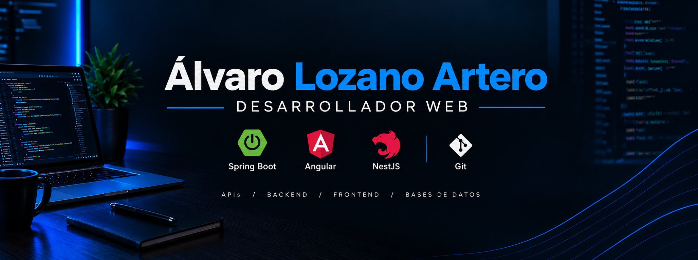

 

  

   
   

  

  <h1>Álvaro Lozano Artero</h1>

  <h3>Desarrollador de Aplicaciones Web</h3>

  
<strong>Diseñando. Desarrollando. Evolucionando.</strong>

  
Desarrollo de aplicaciones web · Backend · Frontend · Bases de datos

   

  
  
  

   
   

  
  
  

---

## 01 · Perfil profesional

Soy estudiante de segundo curso del **Ciclo Formativo de Grado Superior en Desarrollo de Aplicaciones Web (DAW)**, con especial interés en la ingeniería de software y la creación de soluciones digitales.

Mi enfoque combina el desarrollo frontend, la programación backend y la gestión de bases de datos para comprender el funcionamiento de una aplicación de principio a fin.

Actualmente, estoy profundizando en el ecosistema **Java, Spring Boot, Angular y MySQL**, aplicando mis conocimientos mediante proyectos académicos y personales.

Me interesa construir aplicaciones con una arquitectura clara, código mantenible, separación de responsabilidades y una experiencia de usuario cuidada.

Mi objetivo es seguir evolucionando como desarrollador, ampliar mis competencias técnicas y transformar cada proyecto en una oportunidad para aprender, experimentar y mejorar.

---

## 02 · Tecnologías y herramientas

  Tecnologías relacionadas con mi formación y aprendizaje práctico.

<table>
  <tr>
    <td width="50%" valign="top">
      <h3>01. Desarrollo frontend</h3>
      

        
      

      <table>
        <tr><th>Tecnología</th><th>Aplicación</th></tr>
        <tr><td>HTML5</td><td>Estructura web</td></tr>
        <tr><td>CSS3</td><td>Diseño y presentación</td></tr>
        <tr><td>JavaScript</td><td>Programación frontend</td></tr>
        <tr><td>TypeScript</td><td>Tipado estático</td></tr>
        <tr><td>Angular</td><td>Aplicaciones web</td></tr>
        <tr><td>Vue.js</td><td>Interfaces de usuario</td></tr>
      </table>
    </td>
    <td width="50%" valign="top">
      <h3>02. Desarrollo backend</h3>
      

        
      

      <table>
        <tr><th>Tecnología</th><th>Aplicación</th></tr>
        <tr><td>Java</td><td>Programación</td></tr>
        <tr><td>Spring Boot</td><td>Aplicaciones backend</td></tr>
        <tr><td>PHP</td><td>Desarrollo del servidor</td></tr>
        <tr><td>Laravel</td><td>Aplicaciones web</td></tr>
        <tr><td>NestJS</td><td>Servicios con Node.js</td></tr>
      </table>
    </td>
  </tr>
  <tr>
    <td width="50%" valign="top">
      <h3>03. Bases de datos</h3>
      

        
      

      <table>
        <tr><th>Tecnología</th><th>Aplicación</th></tr>
        <tr><td>MySQL</td><td>Gestión de datos</td></tr>
        <tr><td>SQL</td><td>Consultas y manipulación</td></tr>
        <tr><td>Modelado relacional</td><td>Estructuración de datos</td></tr>
      </table>
    </td>
    <td width="50%" valign="top">
      <h3>04. Herramientas y despliegue</h3>
      

        
      

      <table>
        <tr><th>Herramienta</th><th>Aplicación</th></tr>
        <tr><td>Git</td><td>Control de versiones</td></tr>
        <tr><td>Docker</td><td>Contenedores</td></tr>
        <tr><td>AWS</td><td>Servicios en la nube</td></tr>
        <tr><td>Postman</td><td>Pruebas de APIs</td></tr>
        <tr><td>Figma</td><td>Diseño de interfaces</td></tr>
      </table>
    </td>
  </tr>
</table>

---

## 03 · Metodología de desarrollo

Mi forma de abordar los proyectos se basa en dividir los problemas en partes manejables, mantener una estructura organizada y priorizar la claridad del código.

<table>
  <tr>
    <td width="25%" align="center" valign="top">
      <h3>01</h3>
      
      
<strong>Comprender</strong>

      
Identificar requisitos, definir funcionalidades y delimitar el alcance.

    </td>
    <td width="25%" align="center" valign="top">
      <h3>02</h3>
      
      
<strong>Planificar</strong>

      
Organizar componentes, estructuras de datos y arquitectura.

    </td>
    <td width="25%" align="center" valign="top">
      <h3>03</h3>
      
      
<strong>Implementar</strong>

      
Construir funcionalidades e integrar los distintos componentes.

    </td>
    <td width="25%" align="center" valign="top">
      <h3>04</h3>
      
      
<strong>Evolucionar</strong>

      
Revisar resultados, corregir errores y mejorar las soluciones.

    </td>
  </tr>
</table>

---

## 04 · Proyectos

Desarrollo proyectos académicos y personales para aplicar conocimientos, experimentar con distintas tecnologías y avanzar hacia soluciones cada vez más completas.

  

<table>
  <tr>
    <td width="50%" valign="top">
      <h3>Qué encontrarás</h3>
      <ul>
        <li>Aplicaciones web desarrolladas durante mi formación.</li>
        <li>Proyectos personales y experimentos tecnológicos.</li>
        <li>Ejemplos de programación y soluciones prácticas.</li>
        <li>Código fuente y documentación disponible.</li>
      </ul>
    </td>
    <td width="50%" valign="top">
      <h3>Qué puedes consultar</h3>
      <ul>
        <li>Tecnologías utilizadas en cada proyecto.</li>
        <li>Organización del código fuente.</li>
        <li>Funcionalidades implementadas.</li>
        <li>Instrucciones de instalación y ejecución, cuando estén documentadas.</li>
      </ul>
    </td>
  </tr>
</table>

---

## 05 · Actividad y métricas de GitHub

  Un resumen visual de mi actividad, los lenguajes que utilizo y mi evolución como desarrollador.

  
  

  

---

## 06 · Contacto y colaboración

Me interesa conectar con personas del sector tecnológico, intercambiar conocimientos y conocer oportunidades de aprendizaje y colaboración.

  
  
  

   
  
  © Álvaro Lozano Artero · Almería, España

